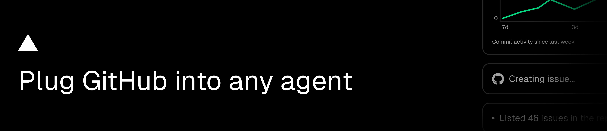

# @github-tools/eve-extension

[](https://npmjs.com/package/@github-tools/eve-extension)
[](https://npm.chart.dev/@github-tools/eve-extension)
[](https://www.typescriptlang.org/)
[](https://github.com/vercel-labs/github-tools/blob/main/LICENSE)

GitHub tools for [eve](https://eve.dev), packaged as a mountable [eve extension](https://eve.dev/docs/extensions): a single `pnpm add` and a one-line mount, with no CLI setup. Built on [`@github-tools/sdk/eve-runtime`](../github-tools) (shared descriptors, execution, and approval helpers).

Docs: **[github-tools.com/frameworks/eve-extension](https://github-tools.com/frameworks/eve-extension)**

This is **the recommended way** to add GitHub tools to an eve agent. The legacy [`createGithubTools`](../github-tools) / per-tool factories from `@github-tools/sdk/eve` (direct `agent/tools/` registration) are **deprecated** in its favor. They keep working for existing agents, but new agents should mount this extension instead.

## Installation

```sh
pnpm add @github-tools/eve-extension
```

`eve` is a required peer dependency, declared as `*`: the consuming agent provides the runtime copy and eve checks the extension's generated capability metadata rather than an npm range. This release is built against eve 1.0.0-rc.6 and mounts on eve 1.0.0-rc.6 or later. `@vercel/connect` is optional (install it only when using `connector`):

```sh
pnpm add eve
```

## Mount it

```ts
// agent/extensions/github.ts
import githubExtension from '@github-tools/eve-extension'

export default githubExtension({
  connector: 'github/my-connector', // or token: process.env.GITHUB_TOKEN
  preset: 'code-review',
  context: { owner: 'vercel-labs', repo: 'github-tools' },
  requireApproval: {
    addPullRequestComment: ({ toolInput }) => toolInput?.owner !== 'vercel-labs',
  },
})
```

> `code-review` pairs cleanly with a Connect `connector`. `maintainer` and `repo-explorer` include gist tools, and GitHub only grants gist access to user access tokens, never the installation tokens Connect mints, so gist calls 403 over Connect. Write tools already require approval via `always()` by default, so a plain `{ someTool: true }` is a no-op, use a predicate (as above) when you actually want to narrow or loosen the default.

`extension/instructions.ts` adds a system instruction on how to use the GitHub tools: the preset's tool rules without its "You are …" opener (`resolveToolGuidance` from `@github-tools/sdk/eve-runtime`), the shared rules, and the working `context`. It depends only on the config, so the prompt cache holds. Write tools also set `label.complete`, so channels show "Created issue on owner/repo#123" once a write succeeds.

The tool file is a `defineDynamic` function that eve runs before every model call, so tools, approval policies, and schema overrides are rebuilt from the extension config in every process, including after Workflow replay and redeploys. With `preset: 'auto'`, the routing is kept for the session with `ctx.memo`, or for the turn with `evaluation.scope: 'turn'`. `toModelOutput` strips `rateLimit` from the model-facing payload; the execute result still carries it for hooks and channels. Do not use the deprecated `@github-tools/sdk/connect/eve` one-liner for durable Slack/multi-turn agents.

`connector` also accepts a `() => string | Promise<string>` resolver, so the same config can pick a connector dynamically (e.g. by environment):

```ts
export default githubExtension({
  connector: () => (process.env.VERCEL_ENV === 'production' ? 'github/prod-connector' : 'github/preview-connector'),
  preset: 'code-review',
})
```

A GitHub App installed on several accounts needs no configuration: each token is minted for the installation that owns the call's target `owner/repo`, after `context` defaults. Tools without a repository target use the connector's default installation. Set `installationId`, `authorizationDetails` or `repositories` in `connect` to pin one installation. If the App is not installed on the target account, the tool returns `CONNECT_INSTALLATION_REQUIRED` naming that account.

Approval requests name the action and its target instead of eve's default `Approve <tool>?`, for example `Merge pull request on vercel-labs/github-tools#176?`, with `owner`, `repo`, and the PR, issue, or discussion number falling back to `context`.

Tools are exposed to the model as `<namespace>__<toolName>`, where `<namespace>` comes from the mount file's name: `agent/extensions/github.ts` yields `github__listPullRequests`, `github__createIssue`, and so on.

To hand-pick an exact set of tools instead of a preset, pass `include`:

```ts
export default githubExtension({
  include: ['getRepository', 'listPullRequests', 'mergePullRequest'],
})
```

`include` **adds** to `preset` (union), use it to pull in a tool a preset is missing. `exclude` **removes** tool names from the resolved `preset` + `include` set, use it to drop a couple of tools from a larger preset:

```ts
export default githubExtension({
  preset: 'maintainer',
  exclude: ['createRepository', 'deleteGist'],
})
```

See the runnable consumer at [`examples/eve`](../../examples/eve).

## Structure

```
extension/
  extension.ts        # defineExtension() config schema (token, connector, preset, include, exclude, requireApproval, ...)
  tools/
    github.ts          # defineDynamic() resolving listEveToolDescriptors(...) into authored defineTool calls
```

## Config schema (`extension/extension.ts`)

| Field | Type | Notes |
|---|---|---|
| `token` | `string \| (() => Promise<string>)` (optional) | PAT string, or an async provider for rotating tokens (e.g. a GitHub App installation token) — the same `GithubTokenInput` the SDK accepts; falls back to `GITHUB_TOKEN` when omitted and `connector` is not set |
| `connector` | `string \| (() => string \| Promise<string>)` (optional) | Vercel Connect connector name, or a resolver to pick one dynamically (e.g. per environment/tenant); takes priority over `token` |
| `actAs` | `'app' \| 'user' \| 'caller' \| { read, write }` (optional) | Whose GitHub access the tools use when `connector` is set. `'app'` (default) uses the GitHub App installation. `'user'` runs each call with the signed-in eve user's own GitHub token, so the agent can do what that user can do on GitHub and nothing more; sessions without a signed-in user fail. `'caller'` uses the user when one drives the turn and the App otherwise (schedules, bots). Users who have not authorized the App get a sign-in prompt and never fall back to the App. `{ read, write }` picks per tool kind, `overrides.<tool>.actAs` per tool. The default may change to `'caller'` in a future major version |
| `approvers` | `'requester' \| 'anyone'` (optional) | Who may answer an approval. `'requester'` (default) is only the person who asked, so a colleague cannot approve your request. `'anyone'` is an opt-in that lets any signed-in user approve and anyone deny; for `'user'` and `'caller'` tools the approved call runs with the approver's GitHub token, after they sign in |
| `connect` | `record \| ((ctx, call) => record)` (optional) | Passed through to `getToken` when `connector` is set. `connect.subject` defaults to `{ type: 'app' }` (the project's GitHub App installation); for per-user tokens, use `actAs`. App tokens target the installation owning each call's repository unless `installationId`, `authorizationDetails` or `repositories` pins one; pass a `(ctx, call) => record` resolver for other per-call rules |
| `preset` | preset name, array, or `'auto'` | `code-review`, `issue-triage`, `ci-ops`, `repo-explorer`, `security-audit`, `release-manager`, `discussion-moderator`, `notification-inbox`, `pr-author`, `maintainer`; `'auto'` lists the tools the session's first request needs and defers the rest |
| `include` | `string[]?` | Tool names to add on top of `preset` (union), or the full set standalone |
| `exclude` | `string[]?` | Tool names to remove from the resolved `preset` + `include` set |
| `context` | `{ owner?, repo?, pullNumber?, issueNumber?, ref? }?` | Default working context for tool inputs and schemas |
| `requireApproval` | `boolean \| 'auto' \| record` | Global or per-tool; per-tool values may be `'auto'` or predicate functions. `'auto'` runs low-risk writes the user asked for without a prompt |
| `evaluation` | `record?` | Tunes the `'auto'` modes: `model`, `maxRisk`, `minIntent`, `selection`, `scope`, `minToolProbability`, `maxTools`, `minPresetProbability`, `maxPresets`, `providerOptions` |
| `overrides` | `record` | Per-tool `description` / `approval` / `actAs` / `toModelOutput` / `outputSchema` |
| `author` / `committer` / `coAuthors` | commit identity | Attribution for commit-creating tools |

## Build (contributors)

```sh
pnpm --filter @github-tools/eve-extension build   # runs `eve extension build`
```

## License

[MIT](../../LICENSE)

Made by [@HugoRCD](https://github.com/HugoRCD)
